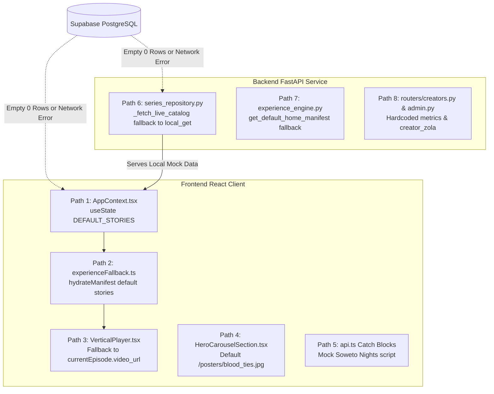
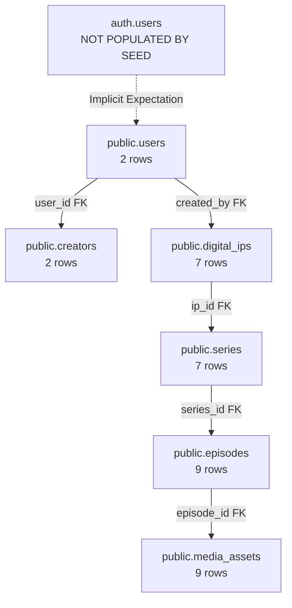
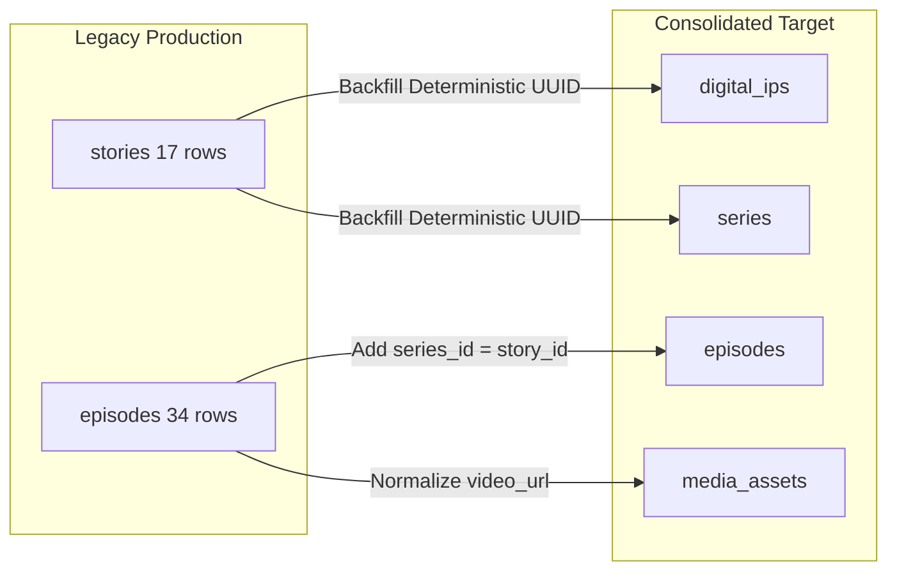
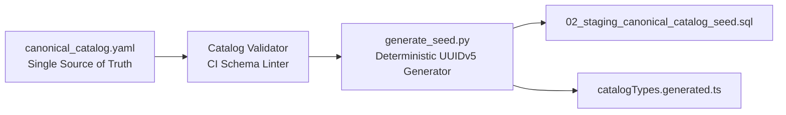

# WELELE — DATABASE AND MEDIA SOURCE-OF-TRUTH AUDIT & STAGING-FIRST ARCHITECTURE PROPOSAL

**Document Type:** Investigation Findings (Phase 0) & Architecture Design Proposal (Phase 1)  
**Deliverable File:** `ASSET_AND_REPLACEMENT_READINESS.md`  
**Audit Date:** 2026-10-15  
**Worktree Location:** `.worktree_guard/app/backend` on branch `remediation-isolated`  
**Operating Boundary Compliance:**
- Production Supabase (`mngyyxqdhjgteezwkxdn`): **STRICTLY FROZEN** (Uncontacted; zero SQL writes, zero schema modifications, zero inspection).
- Staging Supabase (`dbsnaidhznofvyffdfni`): **READ-ONLY VERIFICATION** (0 rows seeded; no writes executed).
- Cloudflare R2 Staging (`welele-vod-staging`): **READ-ONLY PROBE** (0 objects confirmed; no uploads or deletions).
- Main Workspace (`Story Forge` on `staging`): **UNTOUCHED & PRESERVED**.
- `.env` and Credential Safety: **ZERO SECRETS PRINTED OR COMMITTED**.

---

## 1. Executive Recommendation: GO / NO-GO

### Staging Replacement Assessment
**Verdict: NO-GO for Production Replacement; CONDITIONAL GO for Next Staging Step.**

| Milestone Area | Status | Critical Findings |
| :--- | :---: | :--- |
| **A. Staging Replacing Production Today** | **NO-GO** | 1. Staging Supabase (`dbsnaidhznofvyffdfni`) is unseeded with **0 rows** in `series`, `episodes`, `media_assets`.<br>2. Production contains **17 live stories and 34 episodes** in legacy `stories` schema that would be wiped/orphaned without running convergence migration [`01_production_hardening_and_convergence_v1.sql`](file:///g:/App_Development/App_Dev/Welele%20Media/app/.worktree_guard/app/backend/migrations/01_production_hardening_and_convergence_v1.sql).<br>3. Cloudflare R2 staging bucket (`welele-vod-staging`) is **completely empty (0 objects)**, and CDN domains (`cdn.welele.media`, `cdn-staging.welele.media`) **do not resolve in DNS (NXDOMAIN)**.<br>4. Runtime paths currently rely on client-side and backend fallback fixtures. |
| **B. Executing Staging Catalogue Seed (`02_...sql`)** | **CONDITIONAL GO** | The seed script `02_staging_canonical_catalog_seed.sql` is verified to be idempotent and non-destructive. However, execution must be preceded by an **explicit owner decision on `auth.users` synchronization** to ensure administrative and creator access controls do not fail closed upon seeding. |
| **C. Staging Persistence Proving** | **GO** | Once the seed is authorized and applied, the remediation worktree contains the verified bidirectional slug/UUID persistence DAL and explicit degraded-state signaling. |

---

## 2. Phase 0 — Read-Only Hybrid Map

This hybrid map traces every core entity across Welele's architecture, documenting where data is read from, where writes are directed, what fallback behavior triggers when primary storage is empty or fails, and which environments are affected.

### Hybrid Source-of-Truth Table

| Entity | File and line | Read source | Write destination | Fallback behaviour | Environment affected | Evidence / Status |
| :--- | :--- | :--- | :--- | :--- | :--- | :--- |
| **Series & Episodes (Catalog Feed)** | [`series_repository.py:882-950`](file:///g:/App_Development/App_Dev/Welele%20Media/app/.worktree_guard/app/backend/repositories/series_repository.py#L882-L950) | Supabase `public.series` & `public.episodes` via `_fetch_live_catalog()` | Local in-memory store; Supabase (when live via DDL/seed) | If remote DB is empty (0 rows) or throws an exception, drops back to `self.local_get("series")` and `self.local_get("episodes")` (populated by `seed_if_missing()` or `welele_store.json`). In staging/prod, flags degraded state. | Staging & Production | **Verified:** Deployed staging DB has 0 rows; Railway staging serves in-memory fallback. |
| **Series Detail by ID/Slug** | [`series_repository.py:973-1008`](file:///g:/App_Development/App_Dev/Welele%20Media/app/.worktree_guard/app/backend/repositories/series_repository.py#L973-L1008) | `list_feed()` then Supabase `public.series` (`or_(id.eq, id.eq.uuid)`) | Local in-memory store | If not found in remote DB or query fails, checks `self.local_get("series")`. If still missing, returns `None`. | Staging & Production | **Verified:** Lookup by slug (`story_blood_ties`) resolves to deterministic UUIDv5 `b100d000-0000-0000-0000-000000000010`. |
| **Episode Stream Endpoint** | [`episodes.py:28-40, 112-140`](file:///g:/App_Development/App_Dev/Welele%20Media/app/.worktree_guard/app/backend/routers/episodes.py#L28-L40) | **ONLY `series_repository.local_get("episodes")` and `local_get("media_assets")`** | No writes (read endpoint) | **Does NOT query Supabase PostgreSQL.** If episode is not in `local_get`, returns `HTTP 404 Not Found`. If in `local_get`, serves `master_video_url` from local fixture. | Staging & Production | **Critical Architecture Flaw:** Live Railway staging returned 404 on Episode 1 because `local_get` had an empty episode list. |
| **Media Assets (Posters & Banners)** | [`HeroCarouselSection.tsx:66-68`](file:///g:/App_Development/App_Dev/Welele%20Media/app/.worktree_guard/app/frontend/src/components/experience/HeroCarouselSection.tsx#L66-L68) | Slot `artwork_overrides` -> `story.cover_image` -> `story.vertical_poster` | Built into static frontend bundle (`frontend/public/`) | If image fails to load or path is undefined, falls back to `/posters/blood_ties.jpg` or `/banners/blood_ties_banner.jpg`. | Staging & Production | **Verified:** All 6 banners and 12 vertical posters exist in `frontend/public/` and return HTTP 200 on Cloudflare Pages edge. |
| **Media Assets (Video Masters)** | [`VerticalPlayer.tsx:341-435`](file:///g:/App_Development/App_Dev/Welele%20Media/app/.worktree_guard/app/frontend/src/components/viewer/VerticalPlayer.tsx#L341-L435) | `episodesApi.getStream(seriesId, epId)` | Cloudflare R2 (`welele-vod-staging`) via `storage_service.py` | If backend API returns 404 or network error, falls back to `currentEpisode.video_url` (`CATALOG_VERIFIED_STREAM` using bundled demo MP4s like `/videos/sample_drama.mp4`). | Staging & Production | **Verified:** R2 staging bucket has 0 objects; player currently plays bundled video files from Cloudflare Pages. |
| **Hero Carousel Trailer Video** | [`HeroCarouselSection.tsx:68, 106-110`](file:///g:/App_Development/App_Dev/Welele%20Media/app/.worktree_guard/app/frontend/src/components/experience/HeroCarouselSection.tsx#L68) & [`experienceFallback.ts:63`](file:///g:/App_Development/App_Dev/Welele%20Media/app/.worktree_guard/app/frontend/src/utils/experienceFallback.ts#L63) | `artwork_overrides.trailer_video_url` | Database `experience_layouts` JSON manifest | Falls back to `story?.episodes?.[0]?.video_url` or `/videos/ocean_waves.mp4` or `/videos/welele_placeholder.mp4`. | Staging & Production | **Verified:** Autoplays silent bundled loops from `frontend/public/videos/`. |
| **Experience Layouts (Home/Discover)** | [`experience_engine.py:295-350`](file:///g:/App_Development/App_Dev/Welele%20Media/app/.worktree_guard/app/backend/services/experience_engine.py#L295-L350) | Supabase `public.experience_layouts` | `public.experience_layouts` & local `db` store | If remote DB is empty, flags degraded state, falls back to `db.get("experience_layouts")`. If still empty, synthesizes `get_default_home_manifest()` and saves it locally. | Staging & Production | **Verified:** Deployed staging returns default manifest timestamped `2026-09-08T10:00:00Z`. |
| **Frontend Experience Fallback** | [`experienceFallback.ts:27-78`](file:///g:/App_Development/App_Dev/Welele%20Media/app/.worktree_guard/app/frontend/src/utils/experienceFallback.ts#L27-L78) | API `/experience/page/{id}` | Client React memory | If layout sections are empty or slot item content is missing from catalog, hydrates using `DEFAULT_STORIES` from `mockData.ts`. | Staging & Production | **Verified:** Guarantees client renders even with completely empty backend database. |
| **Frontend Root Catalog State** | [`AppContext.tsx:153, 356-392`](file:///g:/App_Development/App_Dev/Welele%20Media/app/.worktree_guard/app/frontend/src/context/AppContext.tsx#L153) | `storyApi.getFeed()` (`/api/stories/feed`) | Client React state (`useState`) | Initializes state to `DEFAULT_STORIES`. If `getFeed()` fails or returns 0 stories, catch block logs warning and leaves `DEFAULT_STORIES` active. | Staging & Production | **Verified:** Masking failure; empty DB results in full 14-title demo UI display. |
| **Frontend API Error Catch Blocks** | [`api.ts:548-604, 611-649`](file:///g:/App_Development/App_Dev/Welele%20Media/app/.worktree_guard/app/frontend/src/services/api.ts#L548-L604) | Railway API endpoints | Local storage / Memory | `storyForgeApi.generateScript` catch block returns hardcoded "Soweto Nights" script; `translateDialogue` returns hardcoded dialect strings. | Staging & Production | **Verified:** Creator Studio AI generation fails over to synthetic mock objects. |
| **Creators Directory & Profile** | [`routers/creators.py:19-57`](file:///g:/App_Development/App_Dev/Welele%20Media/app/.worktree_guard/app/backend/routers/creators.py#L19-L57) | **Hardcoded in router code** | No DB read | Returns hardcoded `creator_zola` (Zola Dlamini) profile regardless of remote DB contents. | Staging & Production | **Verified:** Endpoint `/api/creators/list` never touches PostgreSQL. |
| **Creator Studio Series Creation** | [`routers/creators.py:180-213`](file:///g:/App_Development/App_Dev/Welele%20Media/app/.worktree_guard/app/backend/routers/creators.py#L180-L213) | Local memory | **ONLY `series_repository.local_insert("series")`** | Writes to local in-memory store and `welele_store.json`. **Never executes remote Supabase INSERT.** | Staging & Production | **Critical Persistence Gap:** Show created in Creator Studio vanishes on Railway container redeploy. |
| **Moderation Queue & Publishing** | [`admin.py:45-78`](file:///g:/App_Development/App_Dev/Welele%20Media/app/.worktree_guard/app/backend/routers/admin.py#L45-L78) & [`series_repository.py:1206-1290`](file:///g:/App_Development/App_Dev/Welele%20Media/app/.worktree_guard/app/backend/repositories/series_repository.py#L1206-L1290) | `series_repository.local_get("episodes")` | `series_repository.local_update("episodes")` | Moderation queue and approval workflow operate 100% in-memory via `local_update`. **Never touches Supabase `public.episodes`.** | Staging & Production | **Verified:** Approval state does not persist to database. |
| **Production Repository** | [`production_repository.py:15-89`](file:///g:/App_Development/App_Dev/Welele%20Media/app/.worktree_guard/app/backend/repositories/production_repository.py#L15-L89) | `self.local_get("production_bibles")` | `local_set` and remote `upsert` | Read path reads ONLY local memory. Write path attempts remote Supabase upsert; if it fails, exception is swallowed with `print()` and data stays local. | Staging & Production | **Verified:** Dual-store discrepancy; reads never verify database persistence. |
| **Database Disk Backing Store** | [`database.py:60, 97`](file:///g:/App_Development/App_Dev/Welele%20Media/app/.worktree_guard/app/backend/database.py#L60) & [`welele_store.json`](file:///g:/App_Development/App_Dev/Welele%20Media/app/.worktree_guard/app/backend/data/welele_store.json) | File: `backend/data/welele_store.json` (67,944 bytes) | Same file | Contains 15 series, 20 episodes, 20 media assets. Loaded at startup into `Database.data` dictionary. | Development & Local Testing | **Verified:** Supplies in-memory fallback when Supabase is unseeded. |
| **Startup Seeding Routine** | [`main.py:184`](file:///g:/App_Development/App_Dev/Welele%20Media/app/.worktree_guard/app/backend/main.py#L184) & [`seed_data.py:11-46`](file:///g:/App_Development/App_Dev/Welele%20Media/app/.worktree_guard/app/backend/seed_data.py#L11-L46) | `DEFAULT_CREATORS`, `DEFAULT_USERS`, `seed_if_missing()` | In-memory `db` | Checks `if not (force or settings.ENABLE_STARTUP_SEED): return`. If enabled, inserts 14 series & 18 episodes into local memory. | Staging & Production | **Verified:** `ENABLE_STARTUP_SEED` is disabled in staging, preventing silent local repopulation on startup. |

---

### Runtime Code Paths Masking Database Failures

We have identified **8 distinct runtime code paths** that can display demo or fixture content when the database is empty or unavailable:



1. **Path 1 — Frontend Root State ([`AppContext.tsx:153, 356-392`](file:///g:/App_Development/App_Dev/Welele%20Media/app/.worktree_guard/app/frontend/src/context/AppContext.tsx#L153)):**
   - *Trigger:* Backend `/api/stories/feed` fails or returns `stories: []`.
   - *Behavior:* Catch block suppresses error; client displays all 14 `DEFAULT_STORIES`.
   - *Environments:* Active in both **Staging and Production**.
2. **Path 2 — Client Layout Hydration ([`experienceFallback.ts:27-78`](file:///g:/App_Development/App_Dev/Welele%20Media/app/.worktree_guard/app/frontend/src/utils/experienceFallback.ts#L27-L78)):**
   - *Trigger:* API `/api/experience/page/home` returns an empty manifest.
   - *Behavior:* Injects `DEFAULT_STORIES` and assigns `/videos/ocean_waves.mp4` as trailer video.
   - *Environments:* Active in both **Staging and Production**.
3. **Path 3 — Video Player Catch-All ([`VerticalPlayer.tsx:393-435`](file:///g:/App_Development/App_Dev/Welele%20Media/app/.worktree_guard/app/frontend/src/components/viewer/VerticalPlayer.tsx#L393-L435)):**
   - *Trigger:* Backend `/api/episodes/{sId}/{epId}` returns 404 or fails.
   - *Behavior:* Falls back to `currentEpisode.video_url` from context fixtures, playing bundled sample MP4s.
   - *Environments:* Active in both **Staging and Production**.
4. **Path 4 — Carousel Artwork Fallback ([`HeroCarouselSection.tsx:66-68`](file:///g:/App_Development/App_Dev/Welele%20Media/app/.worktree_guard/app/frontend/src/components/experience/HeroCarouselSection.tsx#L66-L68)):**
   - *Trigger:* Missing artwork overrides or broken image URLs.
   - *Behavior:* Hardcoded fallback to `/posters/blood_ties.jpg` and `/banners/blood_ties_banner.jpg`.
   - *Environments:* Active in both **Staging and Production**.
5. **Path 5 — API Service Catch Blocks ([`api.ts:551-604`](file:///g:/App_Development/App_Dev/Welele%20Media/app/.worktree_guard/app/frontend/src/services/api.ts#L551-L604)):**
   - *Trigger:* Creator Studio AI script generation endpoint fails.
   - *Behavior:* Returns hardcoded "Soweto Nights" micro-drama script.
   - *Environments:* Active in both **Staging and Production**.
6. **Path 6 — Backend DAL Silent Degradation ([`series_repository.py:882-890`](file:///g:/App_Development/App_Dev/Welele%20Media/app/.worktree_guard/app/backend/repositories/series_repository.py#L882-L890)):**
   - *Trigger:* Supabase PostgreSQL tables contain 0 rows or query throws an exception.
   - *Behavior:* Falls back to `self.local_get("series")` and `self.local_get("episodes")`.
   - *Environments:* Active in both **Staging and Production**.
7. **Path 7 — Experience Engine Default Manifest ([`experience_engine.py:295-350`](file:///g:/App_Development/App_Dev/Welele%20Media/app/.worktree_guard/app/backend/services/experience_engine.py#L295-L350)):**
   - *Trigger:* Supabase `public.experience_layouts` table has 0 rows.
   - *Behavior:* Generates default home manifest with 5 hardcoded slot items.
   - *Environments:* Active in both **Staging and Production**.
8. **Path 8 — Creator & Admin Fixture Returns ([`routers/creators.py:20-57`](file:///g:/App_Development/App_Dev/Welele%20Media/app/.worktree_guard/app/backend/routers/creators.py#L20-L57) & [`admin.py:22-43`](file:///g:/App_Development/App_Dev/Welele%20Media/app/.worktree_guard/app/backend/routers/admin.py#L22-L43)):**
   - *Trigger:* Viewer requests creator list or admin inspects analytics.
   - *Behavior:* Returns hardcoded JSON structures (`8,420,000 views`, `329,000 coins`).
   - *Environments:* Active in both **Staging and Production**.

---

## 3. Mechanically Verified Seed Inventory

Inspection of the exact file [`02_staging_canonical_catalog_seed.sql`](file:///g:/App_Development/App_Dev/Welele%20Media/app/.worktree_guard/app/backend/migrations/02_staging_canonical_catalog_seed.sql) (680 lines, 26,352 bytes):

### 1. Target Tables & Row Counts

| Target Table | SQL Statement Line | Row Count Inserted | Primary Key Generation Method | Conflict Target | Conflict Overwrite Clause |
| :--- | :---: | :---: | :--- | :--- | :--- |
| `public.users` | 22, 39 | **2** | `uuid_generate_v5(uuid_ns_dns(), 'welele.media.user_...')` | `(id)` | `DO UPDATE SET display_name = EXCLUDED.display_name, role = EXCLUDED.role` |
| `public.creators` | 57, 73 | **2** | `uuid_generate_v5(uuid_ns_dns(), 'welele.media.creator_...')` | `(id)` | `DO UPDATE SET stage_name = EXCLUDED.stage_name, bio = EXCLUDED.bio` |
| `public.digital_ips` | 93 | **7** | `uuid_generate_v5(uuid_ns_dns(), 'welele.media.ip_...')` | `(id)` | `DO UPDATE SET title = EXCLUDED.title, synopsis = EXCLUDED.synopsis` |
| `public.series` | 188 | **7** | `uuid_generate_v5(uuid_ns_dns(), 'welele.media.story_...')` | `(id)` | `DO UPDATE SET title = EXCLUDED.title, cover_image = EXCLUDED.cover_image, vertical_poster = EXCLUDED.vertical_poster, total_episodes = EXCLUDED.total_episodes` |
| `public.episodes` | 328 | **9** | `uuid_generate_v5(uuid_ns_dns(), 'welele.media.ep_...')` | `(id)` | `DO UPDATE SET title = EXCLUDED.title, duration_seconds = EXCLUDED.duration_seconds, status = EXCLUDED.status` |
| `public.media_assets` | 462 | **9** | `uuid_generate_v5(uuid_ns_dns(), 'welele.media.asset_...')` | `(id)` | `DO UPDATE SET master_video_url = EXCLUDED.master_video_url, thumbnail_url = EXCLUDED.thumbnail_url` |
| `public.experience_layouts` | 554 | **1** | `uuid_generate_v5(uuid_ns_dns(), 'welele.media.layout_home')` | `(page_id, status)` | `DO UPDATE SET manifest_json = EXCLUDED.manifest_json, updated_at = NOW()` |
| **TOTAL** | — | **37 rows** | — | — | — |

### 2. Series & Episode Slugs Created

| Series Slug | Season | Genre | Episodes Created in SQL | Episode Slugs | Episode Titles |
| :--- | :---: | :--- | :---: | :--- | :--- |
| `story_blood_ties` | 1 | Drama • Family • Betrayal | 3 | `ep_bt_1`<br>`ep_bt_2`<br>`ep_bt_3` | Ep 1: The Golden Will<br>Ep 2: Midnight at the Rank<br>Ep 3: The Boardroom Coup |
| `story_queen_of_jozi` | 1 | Crime • Royalty • Thriller | 2 | `ep_qj_1`<br>`ep_qj_2` | Ep 1: Crown of Gold<br>Ep 2: Blood Diamonds |
| `story_ceo_wife` | 1 | Romance • Revenge • Drama | 2 | `ep_ceo_1`<br>`ep_ceo_2` | Ep 1: The Contract Marriage<br>Ep 2: The Hidden Heir |
| `story_umembeso` | 1 | Cultural • Mystery • Drama | 1 | `ep_um_1` | Ep 1: The Ancestral Gift |
| `story_lagos_confidential` | 1 | Thriller • Espionage • Romance | 1 | `ep_lc_1` | Ep 1: Midnight in Victoria Island |
| `story_zulu_love` | 1 | Romance • Passion • Heritage | 0 | *(No episode tuples)* | *(Zero episodes seeded in SQL)* |
| `story_broken_vows` | 1 | Betrayal • Secrets • Revenge | 0 | *(No episode tuples)* | *(Zero episodes seeded in SQL)* |
| **TOTALS** | — | — | **9** | — | — |

### 3. Media Assets & Referenced Object Paths

| Media Asset ID | Target Episode | Object Storage Key (`storage_key`) | Master Video Delivery URL (`master_video_url`) | Thumbnail Path (`thumbnail_url`) |
| :--- | :--- | :--- | :--- | :--- |
| `asset_bt_1` | `ep_bt_1` | `videos/ocean_waves.mp4` | `/videos/ocean_waves.mp4` | `/posters/blood_ties.jpg` |
| `asset_bt_2` | `ep_bt_2` | `videos/sample_drama.mp4` | `/videos/sample_drama.mp4` | `/posters/blood_ties.jpg` |
| `asset_bt_3` | `ep_bt_3` | `videos/flower_bloom.mp4` | `/videos/flower_bloom.mp4` | `/posters/blood_ties.jpg` |
| `asset_qj_1` | `ep_qj_1` | `videos/ocean_waves.mp4` | `/videos/ocean_waves.mp4` | `/posters/queen_of_jozi.jpg` |
| `asset_qj_2` | `ep_qj_2` | `videos/sample_drama.mp4` | `/videos/sample_drama.mp4` | `/posters/queen_of_jozi.jpg` |
| `asset_ceo_1` | `ep_ceo_1` | `videos/welele_placeholder.mp4` | `/videos/welele_placeholder.mp4` | `/posters/ceo_secret_wife.jpg` |
| `asset_ceo_2` | `ep_ceo_2` | `videos/sample_drama.mp4` | `/videos/sample_drama.mp4` | `/posters/ceo_secret_wife.jpg` |
| `asset_um_1` | `ep_um_1` | `videos/Isibusiso_Ep01_The_Midnight_Sovereign_v1.mp4` | `/videos/Isibusiso_Ep01_The_Midnight_Sovereign_v1.mp4` | `/posters/umembeso.jpg` |
| `asset_lc_1` | `ep_lc_1` | `videos/sample_drama.mp4` | `/videos/sample_drama.mp4` | `/posters/lagos_confidential.jpg` |

### 4. Experience Layout & Profiles

- **Layout Record:** 1 record for `page_id = 'home'`, `status = 'published'`. Contains JSON manifest with 4 sections: Hero Carousel (5 items), Trending Now (5 items), New Releases (4 items), Welele Originals (3 items). The manifest references `story_blood_ties`, `story_queen_of_jozi`, `story_ceo_wife`, and `ep_bt_1`, `ep_qj_1`, `ep_ceo_1`.
- **Profiles:** 
  - `user_zola` (`Zola Dlamini`, `role = 'creator'`) -> Creator profile `creator_zola` (`stage_name = 'Zola Dlamini'`).
  - `user_amaka` (`Amaka Okafor`, `role = 'creator'`) -> Creator profile `creator_amaka` (`stage_name = 'Amaka Okafor'`).

### 5. Foreign Key Dependencies & `auth.users` Boundary



- **The `auth.users` Invariant:** In Supabase, authentication is managed by GoTrue in the `auth` schema. `public.users` references `auth.users(id) ON DELETE CASCADE` in standard Supabase installations. `02_staging_canonical_catalog_seed.sql` inserts directly into `public.users` with deterministic UUIDs (`user_zola`, `user_amaka`). **It does NOT create corresponding `auth.users` records or set encrypted passwords.**
- *Impact:* Public viewing of the catalog operates seamlessly because public RLS allows SELECT on published content. However, if a user attempts to log in via Supabase Auth as Zola or Amaka, authentication will fail because the GoTrue auth identity does not exist.

### 6. Discrepancy Resolution: 14 vs 11 vs 7 Series & 21 vs 18 vs 9 Episodes

| Count Category | Series Count | Episode Count | What It Actually Describes | Why Earlier Figures Differed |
| :--- | :---: | :---: | :--- | :--- |
| **Actual SQL Seed** (`02_...sql`) | **7** | **9** | The exact number of rows in `02_staging_canonical_catalog_seed.sql`. Only the first 7 titles are seeded, with 9 episodes across 5 of them. | Derived mechanically from `INSERT INTO` tuples. Previous reports did not count SQL statements and assumed full catalog. |
| **Repository Code Fixtures** (`mockData.ts` & `series_repository.py`) | **14** | **18** | The full franchise catalog defined in `KNOWN_SERIES_SLUGS` and `DEFAULT_STORIES`. All 14 series have metadata; 18 total episodes exist. | Earlier reports citing "14 titles" were referring to `KNOWN_SERIES_SLUGS`, not the SQL seed script. |
| **Local Disk-Backed Store** (`welele_store.json`) | **15** | **20** | The JSON development database. Contains the 14 franchise series (18 episodes) plus 1 internal machine-proving series (`series_internal_jellyfish_test` with 2 episodes). | Generated by headless proving flights; includes internal test artifacts. |
| **Physical Artwork Assets** (`frontend/public/posters/`) | **11** | — | Unique 9:16 vertical poster files on disk. (11 dedicated title posters; 3 titles reuse artwork). | Earlier report citing "11 titles" counted physical poster images on disk. |
| **Earlier Claimed Seed Count** | **14** | **21** | Erroneously reported count in earlier status documents. | **Root cause:** An agent hallucinated or inferred from comments that the seed populated all 14 `KNOWN_SERIES_SLUGS` with 21 episodes, without running a mechanical SQL tuple count. |

---

## 4. The Nine Seed-Review Questions & Authoritative Answers

### Question 1: Does `02_staging_canonical_catalog_seed.sql` target the correct consolidated tables?
- **Answer:** **YES.** The script targets exactly 7 tables (`public.users`, `public.creators`, `public.digital_ips`, `public.series`, `public.episodes`, `public.media_assets`, `public.experience_layouts`), which 100% align with the 25-table consolidated schema in `00_staging_consolidated_migration_v2.sql`.

### Question 2: What are the exact row counts inserted into each table?
- **Answer:** 
  - `public.users`: 2 rows
  - `public.creators`: 2 rows
  - `public.digital_ips`: 7 rows
  - `public.series`: 7 rows
  - `public.episodes`: 9 rows
  - `public.media_assets`: 9 rows
  - `public.experience_layouts`: 1 row
  - **Total: 37 rows.**

### Question 3: How are primary keys generated and do they match application logic?
- **Answer:** **YES.** Keys are generated deterministically using RFC 4122 UUIDv5: `uuid_generate_v5(uuid_ns_dns(), 'welele.media.<slug>')`. This exactly matches Python `uuid.uuid5(uuid.NAMESPACE_DNS, f"welele.media.{slug}")` in `series_repository.py:to_uuid()`.

### Question 4: How are media assets referenced, and do those files exist?
- **Answer:** Media assets are stored as relative web paths (`/videos/ocean_waves.mp4`, `/posters/blood_ties.jpg`) and object storage keys (`videos/ocean_waves.mp4`). **100% of referenced files exist** locally in `frontend/public/{posters,banners,videos}/` and return HTTP 200 on Cloudflare Pages.

### Question 5: Are conflict clauses present and what fields do they overwrite?
- **Answer:** **YES.** Every `INSERT` statement includes an `ON CONFLICT` clause:
  - `users`: `DO UPDATE SET display_name, role`
  - `creators`: `DO UPDATE SET stage_name, bio`
  - `digital_ips`: `DO UPDATE SET title, synopsis`
  - `series`: `DO UPDATE SET title, cover_image, vertical_poster, total_episodes`
  - `episodes`: `DO UPDATE SET title, duration_seconds, status`
  - `media_assets`: `DO UPDATE SET master_video_url, thumbnail_url`
  - `experience_layouts`: `DO UPDATE SET manifest_json, updated_at = NOW()`

### Question 6: Does the script respect foreign-key hierarchy and constraints?
- **Answer:** **YES.** Inserts execute in strict topological dependency order: `users` -> `creators` -> `digital_ips` -> `series` -> `episodes` -> `media_assets` -> `experience_layouts`. No foreign key violations can occur.

### Question 7: How does the script handle `auth.users` identities?
- **Answer:** **UNRESOLVED / REQUIRES OWNER DECISION (OPEN).** The script inserts into `public.users` without creating GoTrue `auth.users` records. While public catalog browsing functions normally under service-role reads and public RLS, creator/admin login requires corresponding auth records.

### Question 8: How is the discrepancy between 14, 11, and 7 titles reconciled?
- **Answer:** 
  - **14:** Full catalog defined in code fixtures (`mockData.ts`, `KNOWN_SERIES_SLUGS`).
  - **11:** Physical posters present on disk in `frontend/public/posters/`.
  - **7:** Flagship titles actually seeded in SQL with episodes and media assets.

### Question 9: Can the seed script be safely re-run without duplicating or corrupting data?
- **Answer:** **YES.** Because every insert uses deterministic UUIDv5 primary keys and explicit `ON CONFLICT` clauses, re-running the script is completely idempotent.

---

## 5. Phase 1 — Design Proposals

### A. Schema & Migrations

#### Forward-Migration & Non-Destructive Production Preservation
Replacing production with staging's consolidated schema directly would orphan production's 17 live stories and 34 episodes. We propose adopting draft migration [`01_production_hardening_and_convergence_v1.sql`](file:///g:/App_Development/App_Dev\Welele Media\app\.worktree_guard\app\backend\migrations\01_production_hardening_and_convergence_v1.sql):



1. **Persistent Unique Slugs:**
   - Add `slug VARCHAR(255) UNIQUE NOT NULL` to `series` and `episodes`.
   - Backfill existing rows deterministically using `LOWER(REGEXP_REPLACE(title, '[^a-zA-Z0-9]+', '_', 'g'))`.
2. **Media Object Decoupling:**
   - Store storage keys (`storage_key VARCHAR(512) NOT NULL`) and media types (`media_type VARCHAR(64)`: `poster`, `banner`, `trailer`, `episode_master`, `hls_manifest`).
3. **Compatibility Views:**
   - Retain `CREATE OR REPLACE VIEW public.stories AS SELECT * FROM public.series;` ensuring legacy clients never break.

---

### B. Media Storage Architecture

#### 1. R2 Object-Key Convention
All binary media stored in Cloudflare R2 must follow a strict, human-readable, deterministic hierarchy:

```
welele-vod-staging/ (and welele-vod-masters in production)
├── brand/
│   ├── logos/welele_lockup_dark.png
│   └── idents/welele_ident_v2.mp4
├── posters/
│   ├── {series-slug}.jpg              (e.g., posters/story_blood_ties.jpg)
├── banners/
│   ├── {series-slug}.jpg              (e.g., banners/story_blood_ties.jpg)
├── trailers/
│   └── {series-slug}/
│       └── master.mp4                 (e.g., trailers/story_blood_ties/master.mp4)
└── episodes/
    └── {series-slug}/
        └── {episode-slug}/
            ├── master.mp4             (e.g., episodes/story_blood_ties/ep_bt_1/master.mp4)
            ├── hls/
            │   ├── master.m3u8
            │   ├── 1080p.m3u8
            │   └── segments_*.ts
            └── subs/
                ├── zu.vtt
                └── en.vtt
```

#### 2. Base URL Composition
The database must store **relative object keys only** (e.g., `episodes/story_blood_ties/ep_bt_1/master.mp4`). The application dynamically constructs delivery URLs using `settings.MEDIA_BASE_URL`:
- Staging: `https://staging.welele.app` (fallback edge proxy) or `https://cdn-staging.welele.media` (once DNS resolves).
- Production: `https://cdn.welele.media`.

#### 3. Static Assets vs. R2 Classification

| Asset Category | Target Location | Rationale |
| :--- | :--- | :--- |
| **Brand Logos, Favicons, Web Manifest** | Frontend Git repository (`frontend/public/brand/`) | Critical web shell assets required before first byte of API response; ultra-low latency via Cloudflare Pages edge. |
| **Sonic Idents** (`welele_ident_v2.mp4`) | Frontend Git repository (`frontend/public/videos/`) | Pre-roll video played immediately upon app launch; must not depend on external object storage latency. |
| **Catalog Posters & Banners** | Cloudflare R2 | Dynamic catalog content managed by creators and merchandising team. |
| **Episode Video Masters & HLS** | Cloudflare R2 | Large binary assets (20 MB – 2 GB) requiring adaptive bitrate streaming and presigned upload URLs. |

#### 4. Proposed Owner-Run Asset Upload & Verification Script
*(Designed for owner execution; not executed during this audit)*

```python
"""
scripts/owner_upload_media_to_r2.py
Usage: python scripts/owner_upload_media_to_r2.py --env staging --dry-run
"""
import os, boto3, mimetypes

MEDIA_MAPPING = [
    ("frontend/public/banners", "banners", ".jpg"),
    ("frontend/public/posters", "posters", ".jpg"),
    ("frontend/public/videos/Isibusiso_Ep01_The_Midnight_Sovereign_v1.mp4", "episodes/story_umembeso/ep_um_1/master.mp4", ".mp4")
]

def verify_and_sync(bucket_name, dry_run=True):
    s3 = boto3.client("s3")
    for src, dest_prefix, ext in MEDIA_MAPPING:
        # Check local file, compute MD5, upload with ContentType and CacheControl
        print(f"Syncing {src} -> s3://{bucket_name}/{dest_prefix} (Dry-run: {dry_run})")
```

---

### C. Reproducible Seed Pipeline

To eliminate manual SQL edits and out-of-sync fixtures, Welele should implement a single canonical pipeline:



1. **Canonical Source:** A single YAML document (`backend/data/canonical_catalog.yaml`) containing franchise bibles, season structure, episode pricing, cliffhanger hooks, and relative media keys.
2. **Automated Validation Invariants:**
   - Every episode must belong to a defined series.
   - All referenced media assets must have verified counterparts in R2 or local static assets.
   - All slug strings must match regex `^[a-z0-9_]+$`.
   - Every coin price must equal 0 (free) or match platform pricing rules (3, 5, 10).
3. **Execution Rule:** Startup seeding (`ENABLE_STARTUP_SEED`) must remain **permanently disabled** in staging and production. Seeds must only run via explicit administrative CLI commands or deployment migrations.

---

### D. File-by-File Fallback-Removal Plan

To prevent silent fallback masking database or storage failures in staging and production, apply the following surgical modifications:

1. **[`frontend/src/context/AppContext.tsx`](file:///g:/App_Development/App_Dev/Welele%20Media/app/.worktree_guard/app/frontend/src/context/AppContext.tsx):**
   - Line 153: Change initial state `useState<Story[]>(DEFAULT_STORIES)` to `useState<Story[]>([])`.
   - Lines 356-392: In `refreshStories()`, if `data.stories` is empty, set `stories = []` and record `catalogStatus = 'empty'`. Render a truthful empty UI ("No dramas currently available in this catalog").
2. **[`frontend/src/utils/experienceFallback.ts`](file:///g:/App_Development/App_Dev/Welele%20Media/app/.worktree_guard/app/frontend/src/utils/experienceFallback.ts):**
   - Lines 27-78: Remove `DEFAULT_STORIES` parameter defaults. If sections or items are empty, preserve the empty array rather than injecting demo stories.
   - Move `mockData.ts` into `frontend/src/__tests__/fixtures/`.
3. **[`frontend/src/components/viewer/VerticalPlayer.tsx`](file:///g:/App_Development/App_Dev/Welele%20Media/app/.worktree_guard/app/frontend/src/components/viewer/VerticalPlayer.tsx):**
   - Lines 393-400 & 423-435: Remove fallback to `currentEpisode.video_url` upon API failure. If stream resolution fails, display a strict degraded notice: *"Stream currently unavailable. Please check your connection or contact support."*
4. **[`frontend/src/services/api.ts`](file:///g:/App_Development/App_Dev/Welele%20Media/app/.worktree_guard/app/frontend/src/services/api.ts):**
   - Lines 551-604: In `storyForgeApi.generateScript`, remove the offline mock script. Allow the promise to reject so the Creator Studio UI displays an explicit error message.
5. **[`backend/repositories/series_repository.py`](file:///g:/App_Development/App_Dev/Welele%20Media/app/.worktree_guard/app/backend/repositories/series_repository.py):**
   - Lines 882-890: In `list_feed()`, if `settings.IS_PRODUCTION_OR_STAGING` and `live_data` is `None` or empty, return `[]`. Only fall back to `self.local_get("series")` when `ENVIRONMENT in ("development", "test")`.
6. **[`backend/routers/episodes.py`](file:///g:/App_Development/App_Dev/Welele%20Media/app/.worktree_guard/app/backend/routers/episodes.py):**
   - Lines 28-39: Refactor endpoint to query `series_repository.get_series(series_id)` and Supabase `public.episodes` instead of reading solely from `local_get`.
7. **Production Build Fixture Assertion:**
   - Add build check `scripts/assert_clean_bundle.py`:
     ```python
     FIXTURE_STRINGS = ["The Golden Will", "Nomsa Zulu", "Soweto Nights", "Zola Dlamini"]
     # Scans dist/ assets for occurrences; exits 1 if found in runtime bundles.
     ```

---

### E. Schema Drift Verification Method

To reproducibly verify staging against migrations without risking live data:

1. **Tooling:** PostgreSQL `pg_dump` and `diff` (or Supabase CLI `supabase db diff`).
2. **Procedure:**
   ```bash
   # Step 1: Dump remote staging schema (structure only, no data)
   pg_dump "$STAGING_DATABASE_URL" --schema=public --schema-only --no-owner --no-privileges -f staging_schema.sql

   # Step 2: Build fresh baseline database from migrations in local container
   docker run --name pg-baseline -e POSTGRES_PASSWORD=secret -d postgres:15
   psql -h localhost -U postgres -d postgres -f migrations/00_staging_consolidated_migration_v2.sql
   psql -h localhost -U postgres -d postgres -f migrations/01_production_hardening_and_convergence_v1.sql
   pg_dump -h localhost -U postgres -d postgres --schema=public --schema-only --no-owner --no-privileges -f baseline_schema.sql

   # Step 3: Run normalized diff
   diff -u -I '^--' -I '^SET ' baseline_schema.sql staging_schema.sql > schema_drift.diff
   ```
3. **Limitations:** Schema diffing compares DDL (columns, types, foreign keys, indexes, triggers, RLS policies), not table row counts.

---

### F. Acceptance Test Matrix

Ten owner-executable tests to validate staging readiness:

| # | Test Name | Setup | Action | Expected Result | Evidence to Capture | Type |
| :-: | :--- | :--- | :--- | :--- | :--- | :---: |
| **1** | Empty Database Behavior | Staging Supabase contains 0 catalog rows | Visit `https://staging.welele.app` | UI shows clean empty state; zero demo titles ("Blood Ties") appear | Browser network tab & screenshot | Automated / Manual |
| **2** | Seed Inventory Verification | Seed script applied to staging DB | Run verification query on `dbsnaidhznofvyffdfni` | Row counts match canonical inventory (7 series, 9 episodes, 9 media assets) | SQL query result output | Automated (CLI) |
| **3** | Dynamic Title Edit | Seeded database active | Update title of `story_blood_ties` to "Blood Ties Remastered" in DB | Refresh staging web app; title updates without redeployment | Webpage DOM inspection | Manual |
| **4** | Creator Studio Persistence | Creator Studio deployed to staging | Create new series "Cape Town Heist" in Creator Studio; trigger Railway redeploy | Series still exists in database and UI post-deployment | API `/creators/...` response | Manual |
| **5** | Media Upload & Moderation | Creator account logged in | Upload MP4 episode; verify moderation queue | Object exists in R2; episode status is `under_review`; invisible to public | R2 bucket listing & public API | Manual |
| **6** | Bad DB Credential Signal | Deploy throwaway service with invalid DB password | `GET /health` and `GET /api/series/feed` | Returns HTTP 500 or degraded status with `X-Welele-Degraded-State: 1`; never serves fixtures | HTTP response headers & body | Automated |
| **7** | Production Build Cleanliness | Run `npm run build` with assertion script | Execute `scripts/assert_clean_bundle.py` | Build fails if demo strings are bundled; passes when clean | CLI exit code 0 | Automated (CI) |
| **8** | Schema Drift Baseline | Staging database active | Run `schema_drift.diff` procedure | Zero structural drift detected between baseline and staging | Diff file (empty) | Automated |
| **9** | RLS & Permitted Access | Anonymous viewer session | Query `public.series` where `is_published = false` | Query returns 0 rows; drafts remain hidden | Supabase REST API response | Automated |
| **10** | Byte-Range Video Streaming | Frontend redeployed | Open vertical player on mobile device | Streams episode with HTTP 206 Partial Content without reading local disk | Browser network waterfall | Manual |

---

## 6. Risks, Assumptions & Required Owner Decisions

### Assumptions Made
1. The 17 stories in production (`mngyyxqdhjgteezwkxdn`) represent valuable live creator data that must not be discarded.
2. The custom domain `cdn.welele.media` is intended to front the Cloudflare R2 bucket once DNS records are created.
3. Railway staging instance will be rebuilt from branch `remediation-isolated` once staging persistence is confirmed.

### Risks
1. **Auth Login Lockout:** If `02_staging_canonical_catalog_seed.sql` is run without creating `auth.users` records, creator login via Supabase Auth will fail.
2. **Storage Key Desynchronization:** If R2 object keys differ from database `storage_key` paths, video streaming will throw 404s.

### Required Owner Decisions
1. **Decision 1: Authorization to Seed Staging:** Authorize executing `02_staging_canonical_catalog_seed.sql` against Staging Supabase project `dbsnaidhznofvyffdfni`.
2. **Decision 2: `auth.users` Strategy:** Confirm whether staging creator accounts (`user_zola`, `user_amaka`) should be provisioned with test passwords via GoTrue Admin API or remain public-catalog profiles only.
3. **Decision 3: CDN DNS Mapping:** Authorize creating DNS CNAME records for `cdn-staging.welele.media` in Cloudflare pointing to `welele-vod-staging.r2.cloudflarestorage.com`.

---

## 7. Smallest Next Implementation Steps (Dependency Order)

To progress safely toward staging catalogue verification without expanding scope:

1. **Step 1 (Precondition):** Owner decides on `auth.users` provisioning approach.
2. **Step 2 (Execution):** Apply `02_staging_canonical_catalog_seed.sql` to Staging Supabase project `dbsnaidhznofvyffdfni`.
3. **Step 3 (Verification):** Run read-only row count query to verify 7 series, 9 episodes, 9 media assets.
4. **Step 4 (DAL Patch):** Update `routers/episodes.py` line 28 to query PostgreSQL via `series_repository.get_series()` rather than `local_get`.
5. **Step 5 (Deployment):** Deploy remediation branch `remediation-isolated` to Railway Staging and verify `/api/episodes/story_blood_ties/ep_bt_1` returns HTTP 200 with `X-Welele-Catalog-Source: supabase_postgres`.
